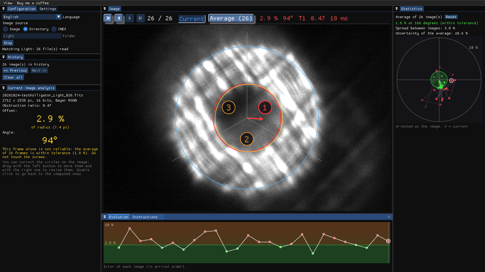

# Kolligator

**Secondary mirror collimation for Schmidt-Cassegrain telescopes, measured
from defocused star images.**

Point the scope at a bright star, defocus it until you see a "donut", and let
Kolligator measure how far the shadow of the secondary mirror is from the
centre of the disk. It tells you which collimation screw to turn, averages
many frames to cancel out the seeing, and helps you see when you are done.



*Español más abajo.*

## About

I wrote Kolligator for myself, as an **aid** to collimation: it judges
whether the primary and secondary mirrors are well aligned better than the
human eye looking at a defocused star does. It does **not** replace more
sophisticated tools made for collimation. Anyone is welcome to use it,
**at their own risk**.

## Download

Get the latest version from the
[**Releases**](../../releases/latest) page:

| File | For |
|---|---|
| `Kolligator-<version>-x86_64.AppImage` | Any 64-bit Linux PC (Intel/AMD). Nothing to install. |
| `kolligator_<version>_amd64.deb` | Ubuntu, Linux Mint, Debian and derivatives on a PC. |
| `Kolligator-<version>-aarch64.AppImage` | Raspberry Pi 4/5 and other 64-bit ARM boards. Nothing to install. |
| `kolligator_<version>_arm64.deb` | Raspberry Pi OS (64-bit), StellarMate OS and other ARM Debian systems. |
| `*.sha256` | Checksums to verify the downloads. |

### AppImage

```bash
chmod +x Kolligator-*.AppImage
./Kolligator-*.AppImage
```

If it complains about FUSE (`libfuse.so.2`), install it with
`sudo apt install libfuse2`, or run it with `--appimage-extract-and-run`.

The first time it runs it adds itself to your applications menu, with its
icon. Its settings file, `kolligator.conf`, is created next to the AppImage.

### .deb

```bash
sudo apt install ./kolligator_*_amd64.deb    # _arm64.deb on a Raspberry Pi
```

Then start **Kolligator** from the applications menu (or `kolligator-gui`
from a terminal). The package also installs `kolligator`, the command line
version.

### Verify the download

With the `.sha256` file in the same folder as the download:

```bash
sha256sum -c Kolligator-*-x86_64.AppImage.sha256
```

It must print `OK`.

## Features

- Reads FITS images (mono or colour, Bayer included) from a folder the camera
  saves into, or straight from an **INDI** server (Ekos, etc.).
- Detects the disk and the secondary shadow, even with seeing, noise or a
  meshed optical pattern, and rejects frames where the shadow is not clear.
- Shows the correction as an arrow on the image and as the screw (third) to
  turn, for the current frame and for the average of the last frames.
- Plots the evolution of the error, frame by frame.
- Lets you drag and resize the detected circles by hand.
- Dockable panels, English and Spanish interface, editable settings file.

## Requirements

- PC (x86_64): Linux with glibc 2.39 or newer (Ubuntu 24.04, Linux Mint 22,
  Debian 13 or later).
- Raspberry Pi / ARM (aarch64): 64-bit Linux with glibc 2.36 or newer
  (Raspberry Pi OS Bookworm, StellarMate OS on Bookworm, or later). On
  StellarMate, connect Kolligator to the local INDI server (`localhost`).
- A camera that saves FITS files, or an INDI server.

## Support

Kolligator is free. If it helped you collimate your scope, you can
[buy me a coffee](https://www.paypal.com/paypalme/Kolligator) ☕ (also from
the program's menu).

Bugs and suggestions: open an [issue](../../issues).

## Licenses

Kolligator is free to use, but it is not open source:
© 2026 JasonDClayton, all rights reserved. It is provided "as is", without
warranty of any kind; you use it at your own risk. It includes open source components
(Dear ImGui, GLFW, CFITSIO and, in the AppImage, the libraries they need),
whose licenses are listed in `THIRD_PARTY_LICENSES.txt`, installed in
`/usr/share/doc/kolligator/` and included inside the AppImage.

---

## Español

**Colimación del secundario de telescopios Schmidt-Cassegrain a partir de
imágenes de una estrella desenfocada.** Kolligator mide cuánto se desvía la
sombra del secundario del centro del "donut", indica qué tornillo tocar y
promedia varias tomas para eliminar el efecto del seeing.

**Descarga** desde [Releases](../../releases/latest):

- **AppImage** (sin instalar): `x86_64` para PC, `aarch64` para Raspberry Pi.
  `chmod +x Kolligator-*.AppImage` y ejecútalo.
- **.deb**: `amd64` para PC (Ubuntu, Linux Mint, Debian), `arm64` para
  Raspberry Pi OS y StellarMate. `sudo apt install ./kolligator_*.deb`.
- **Comprobar la descarga:** `sha256sum -c <fichero>.sha256` debe responder `OK`.

Creé Kolligator para mí, como **ayuda** a la colimación: estima si los
espejos primario y secundario están bien alineados mejor que el ojo humano
mirando una estrella desenfocada. **No** sustituye en ningún caso a
herramientas más sofisticadas y apropiadas para la colimación. Cualquiera
puede usarlo, **bajo su propia responsabilidad**.

La interfaz está en inglés y en español (se cambia desde la ventana).
Kolligator es gratuito; si te ha sido útil puedes
[invitarme a un café](https://www.paypal.com/paypalme/Kolligator) ☕.
